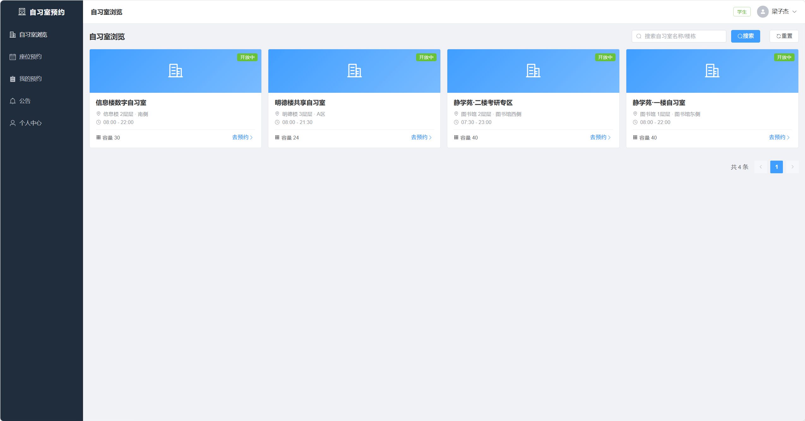
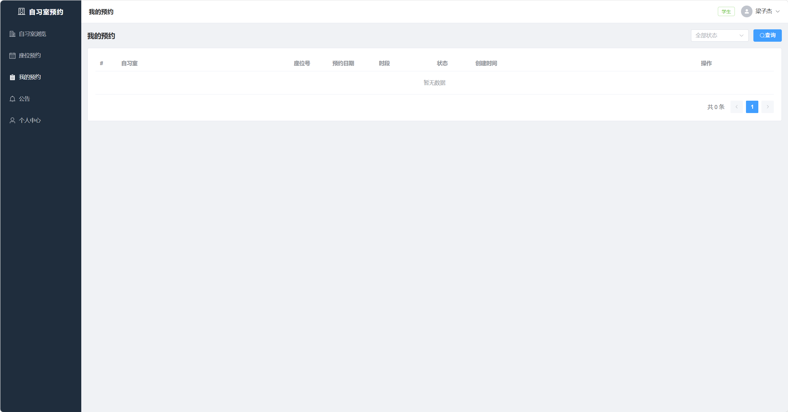
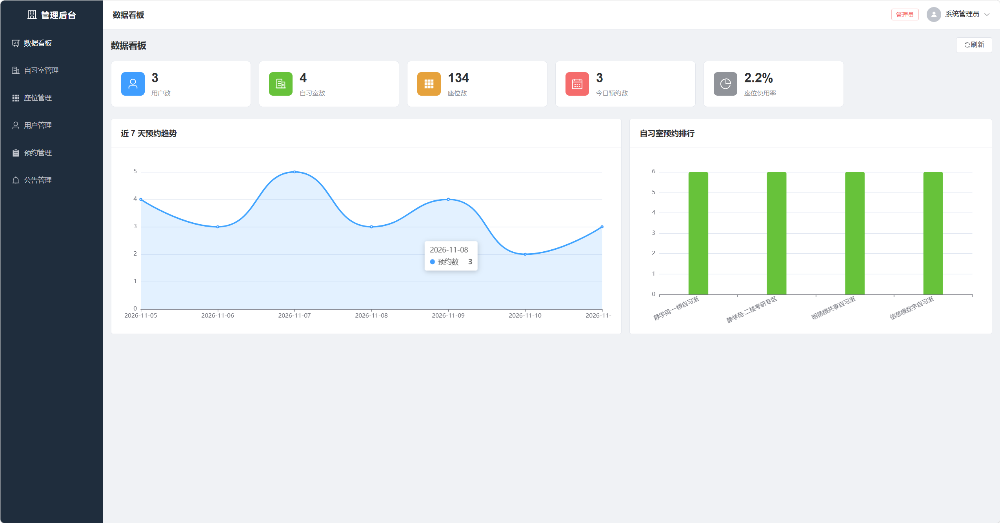
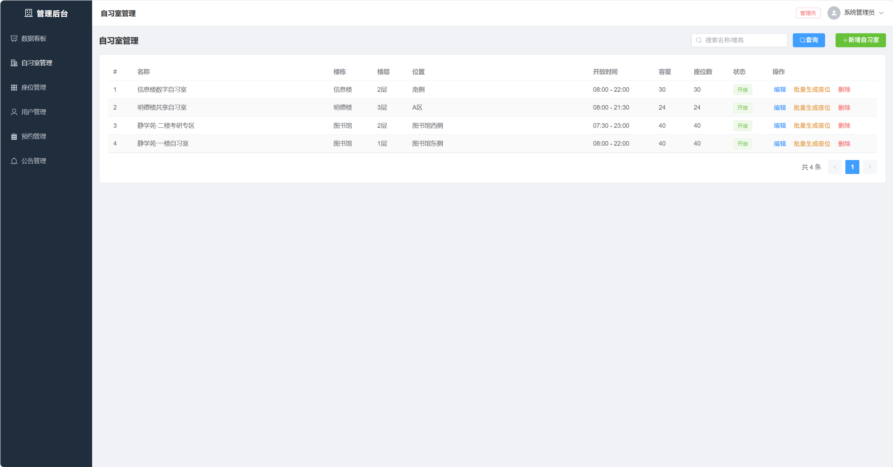
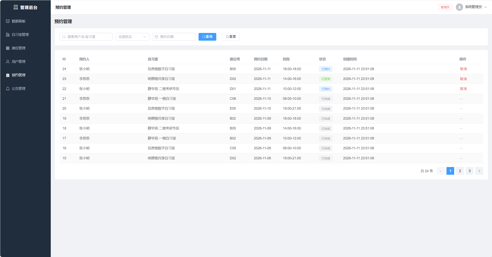

# 校园共享自习室座位预约系统

基于 **Spring Boot 2.7 + Vue 3** 的前后端分离项目，面向校园自习室场景，解决「占座不坐、座位空置」问题，提供按日期与时段的座位预约、签到签退与后台管理能力。

- 后端：Spring Boot 2.7.18 / MyBatis-Plus 3.5.3.1 / MySQL 8.0（或 H2）
- 前端：Vue 3 / Vite 5 / Element Plus / Pinia / Vue Router / Axios / ECharts
- 规模：5 张数据表、8 个控制器、**37 个 RESTful 接口**、12 个前端页面

---

## 功能

### 学生端

| 功能 | 说明 |
| --- | --- |
| 注册 / 登录 | JWT 无状态认证，BCrypt 加密存储密码 |
| 浏览自习室 | 查看开放时间、楼层、容量与简介 |
| 选座预约 | 按日期 + 时段查看座位图，四种状态着色（可用 / 已占用 / 维护中 / 已选） |
| 我的预约 | 查看预约记录，支持签到、签退、取消 |
| 公告 | 查看管理员发布的公告与预约规则 |

### 管理端

| 功能 | 说明 |
| --- | --- |
| 数据看板 | 用户数、自习室数、座位数、今日预约、使用率、近 7 天预约趋势、自习室排行（ECharts） |
| 自习室管理 | 增删改查、开放状态控制 |
| 座位管理 | 按行列批量生成座位、单个维护 |
| 用户管理 | 列表查询、启用 / 禁用、编辑、删除 |
| 预约管理 | 全量预约记录查询与筛选 |
| 公告管理 | 发布、编辑、删除公告 |

---

## 快速开始

### 方式一：H2 内存库（零配置，推荐用于演示）

无需安装 MySQL，启动即自动建表并写入演示数据。

```bash
# 1. 启动后端（默认 profile 为 h2）
cd backend
mvn spring-boot:run

# 2. 启动前端（另开终端）
cd frontend
npm install
npm run dev
```

- 前端地址：http://localhost:5173
- 后端接口：http://localhost:8080
- H2 控制台：http://localhost:8080/h2-console （JDBC URL 见 `application-h2.yml`）

### 方式二：MySQL

```bash
# 1. 执行建表脚本
mysql -uroot -p < backend/src/main/resources/db/mysql/schema.sql

# 2. 修改 backend/src/main/resources/application-mysql.yml 中的账号密码

# 3. 以 mysql profile 启动
cd backend
mvn spring-boot:run -Dspring-boot.run.profiles=mysql
```

### 演示账号

| 角色 | 账号 | 密码 |
| --- | --- | --- |
| 管理员 | admin | 123456 |
| 学生 | student | 123456 |
| 学生 | student2 | 123456 |

---

## 界面预览

### 学生端 · 自习室浏览



### 学生端 · 我的预约



### 管理端 · 数据看板



### 管理端 · 自习室管理



### 管理端 · 预约管理



<!-- 待补充：学生端「座位预约」页面截图（四态座位图），文件名建议 docs/images/06-seat-map.png -->

---

## 数据库设计

| 表名 | 说明 | 关键字段 |
| --- | --- | --- |
| `sys_user` | 用户表 | username、password(BCrypt)、role(STUDENT/ADMIN)、status |
| `study_room` | 自习室表 | name、building、open_time、close_time、capacity、status |
| `seat` | 座位表 | room_id、seat_no、row_index、col_index、status(1可用 0维护中) |
| `reservation` | 预约记录表 | user_id、room_id、seat_id、reserve_date、start_time、end_time、status |
| `notice` | 公告表 | title、content、publisher_id |

预约状态：`0 已预约 → 1 已签到 → 2 已完成`，另有 `3 已取消`、`4 违约（预留）`。

索引：`idx_reservation_seat (seat_id, reserve_date, status)`、`idx_reservation_user (user_id)`、`idx_seat_room (room_id)`。

固定时段共 5 个：08:00-10:00、10:00-12:00、14:00-16:00、16:00-18:00、19:00-21:00。

---

## 接口一览

统一响应结构 `Result<T>`：`{ code, message, data }`，由 `GlobalExceptionHandler` 统一处理异常。

### 认证 `/api/auth`

| 方法 | 路径 | 说明 |
| --- | --- | --- |
| POST | `/register` | 学生注册 |
| POST | `/login` | 登录，返回 JWT |
| GET | `/info` | 获取当前登录用户信息 |

### 自习室 `/api/rooms`

| 方法 | 路径 | 说明 |
| --- | --- | --- |
| GET | `` | 分页查询（学生端仅开放中的） |
| GET | `/all` | 全部自习室（下拉用） |
| GET | `/{id}` | 详情 |
| POST | `` | 新增（管理员） |
| PUT | `/{id}` | 修改（管理员） |
| DELETE | `/{id}` | 删除（管理员） |

### 座位 `/api/seats`

| 方法 | 路径 | 说明 |
| --- | --- | --- |
| GET | `/room/{roomId}` | 自习室座位图 |
| GET | `/available` | 指定日期 + 时段的可用座位 |
| POST | `/batch` | 按行列批量生成座位（管理员） |
| PUT | `/{id}` | 修改座位状态（管理员） |
| DELETE | `/{id}` | 删除座位（管理员） |

### 预约 `/api/reservations`

| 方法 | 路径 | 说明 |
| --- | --- | --- |
| GET | `/slots` | 固定时段列表 |
| GET | `/seat-status` | 指定日期 + 时段的已占用座位集合 |
| POST | `` | 创建预约 |
| GET | `/my` | 我的预约 |
| GET | `` | 全部预约（管理员） |
| PUT | `/{id}/checkin` | 签到 |
| PUT | `/{id}/checkout` | 签退 |
| PUT | `/{id}/cancel` | 取消 |

### 统计 `/api/stats`

| 方法 | 路径 | 说明 |
| --- | --- | --- |
| GET | `/overview` | 总览指标 |
| GET | `/trend` | 近 N 天预约趋势 |
| GET | `/room-ranking` | 自习室预约排行 |

### 用户 `/api/users`

| 方法 | 路径 | 说明 |
| --- | --- | --- |
| GET | `` | 用户列表（管理员） |
| PUT | `/{id}` | 编辑用户（管理员） |
| PUT | `/{id}/status` | 启用 / 禁用（管理员） |
| DELETE | `/{id}` | 删除用户（管理员） |
| PUT | `/profile` | 修改个人资料 |
| PUT | `/password` | 修改密码 |

### 公告 `/api/notices`

| 方法 | 路径 | 说明 |
| --- | --- | --- |
| GET | `` | 公告列表 |
| GET | `/{id}` | 公告详情 |
| POST | `` | 发布（管理员） |
| PUT | `/{id}` | 编辑（管理员） |
| DELETE | `/{id}` | 删除（管理员） |

完整请求 / 响应示例见 [docs/api-contract.md](docs/api-contract.md)。

---

## 项目结构

```
study-room-reservation/
├── backend/                        Spring Boot 后端
│   ├── src/main/java/com/campus/studyroom/
│   │   ├── annotation/             @AdminOnly 自定义注解
│   │   ├── common/                 Result / PageResult / 异常处理 / 常量
│   │   ├── config/                 JWT 拦截器、MyBatis-Plus、跨域、演示数据初始化
│   │   ├── controller/             8 个控制器
│   │   ├── dto/ vo/                入参 / 出参对象
│   │   ├── entity/ mapper/         实体与数据访问
│   │   ├── service/ impl/          业务逻辑
│   │   └── util/                   JWT 工具、登录上下文
│   └── src/main/resources/
│       ├── application.yml         默认 profile = h2
│       ├── application-h2.yml
│       ├── application-mysql.yml
│       └── db/{h2,mysql}/schema.sql
├── frontend/                       Vue 3 前端
│   └── src/
│       ├── api/                    按模块拆分的接口封装
│       ├── layouts/                学生端 / 管理端布局
│       ├── router/                 路由与路由守卫
│       ├── store/                  Pinia 用户状态
│       └── views/                  12 个页面
└── docs/                           接口文档、设计报告
```

---

## 设计要点

1. **四层预约校验**：时段合法性（须命中固定时段表）、日期合法性（不可预约过去）、对象有效性（座位属于该自习室且非维护中）、冲突检测（座位维度 + 用户维度各自不重叠）。
2. **半开区间冲突判断**：使用 `start < 目标时间.end && end > 目标时间.start`，首尾相接的时段（如 10:00 结束与 10:00 开始）不会被误判为冲突。
3. **无状态认证 + 注解鉴权**：JWT 由拦截器统一解析并写入 `UserContext`；`@AdminOnly` 通过 `HandlerMethod` + `AnnotatedElementUtils` 解析，方法级与类级均生效；前端路由守卫只做体验层拦截，权限的最终判断在后端。
4. **座位布局可还原**：`seat` 表记录 `row_index / col_index`，前端用 CSS Grid 按坐标渲染，批量生成时按行列自动编号（A01、A02…）。
5. **双 Profile**：H2 内存库让项目 clone 后零配置即可运行演示，MySQL 用于正式环境，两套建表脚本分开维护。

---

## 已知不足 / TODO

- 预约创建未加分布式锁，高并发下依赖数据库事务与唯一性约束，未做压测验证
- 未接入 Redis 缓存，座位图与看板数据均为实时查询
- 「违约」状态只定义了常量，尚未实现定时任务自动流转
- 缺少单元测试与接口自动化测试
- JWT 密钥写在配置文件中，生产环境应改为环境变量注入

---

课程实训项目，仅用于学习与技术交流。
